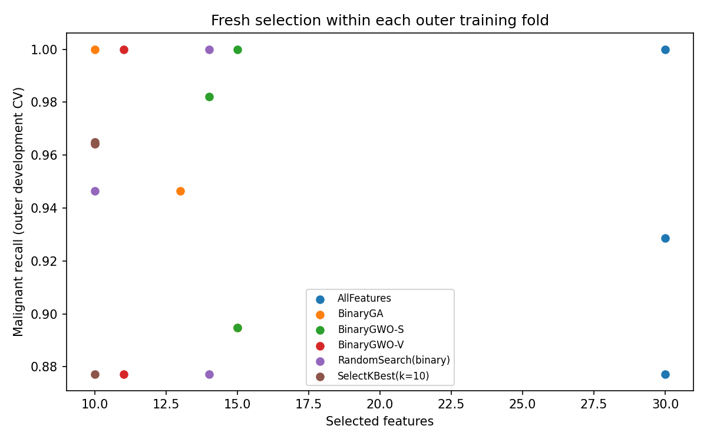

# Breast Cancer Feature Selection

**Binary GA/GWO feature selection, nested cross-validation, and malignant-recall evaluation** on the Breast Cancer Wisconsin (Diagnostic) dataset.

This implemented Project 2 study asks whether binary metaheuristics can reduce feature count while preserving classification performance, especially malignant recall. It reuses the actual installed [Project 1 distribution](https://github.com/Ehsan-Rezaeii/metaheuristics-lab) at commit `6b4ef0fa3d72f608146f3dd7eabb84bf39fa896e`; optimizer implementations are not copied here.

The full 90-call protocol was executed. GWO-S retained 15/30 features and matched AllFeatures' holdout recall of 40/42 (0.9524); GA and GWO-V missed four malignant cases versus two for AllFeatures. This mixed result does **not** establish superiority or clinical equivalence. See [measured results and limitations](docs/RESULTS.md), including the preflight holdout-access caveat.

**Educational methodological study only. Not for clinical diagnosis or patient care.**

## Install

Python 3.11 or 3.12 and Git are required. The source dependency needs GitHub access; no PyPI release of Project 1 is assumed.

```bash
git clone https://github.com/Ehsan-Rezaeii/breast-cancer-feature-selection.git
cd breast-cancer-feature-selection
python -m venv .venv
source .venv/bin/activate
python -m pip install -e '.[dev]'
export OMP_NUM_THREADS=1 OPENBLAS_NUM_THREADS=1 MKL_NUM_THREADS=1
# Writable plotting/font caches are useful in restricted environments:
export MPLCONFIGDIR=/tmp/p2-mpl XDG_CACHE_HOME=/tmp/p2-cache
```

Scientific dependency versions are pinned in pyproject.toml. The measured environment, including transitive packages, is recorded in results/full/requirements_environment.txt; this is an environment snapshot, not the preferred installation command. Code is MIT-licensed; the dataset has separate attribution below.

## Fast verification

```bash
ruff check .
ruff format --check .
pytest -q
python experiments/smoke_test.py
# Alternative: retain a synthetic pilot's artifacts in a fresh directory
bcfs-study smoke --output results/smoke-local
python -m build
python experiments/audit_results.py results/full
```

Smoke uses deterministic synthetic data, 4 calls, population 3 and one seed; it does not measure the WDBC holdout. Tests also verify WDBC invariants and development-only optimizer behavior. CI runs lint, format, tests, a synthetic smoke, artifact audit, build and a clean wheel install/import on Python 3.11 and 3.12. It does not run the full scientific experiment.

## Reproduce the full study

Use a fresh output directory. These commands run the predefined protocol, not hyperparameter tuning:

```bash
bcfs-study develop --output results/reproduction
# Inspect development artifacts, protocol and freeze.json before final access.
bcfs-study final --output results/reproduction
bcfs-study report --output results/reproduction
python experiments/audit_results.py results/reproduction
# Include the newly derived cost_summary.csv in the checksum manifest:
bcfs-study report --output results/reproduction
python experiments/audit_results.py results/reproduction
```

The final command refuses a second holdout evaluation in the same directory. Future tuning cannot reuse this scientific test split as an untouched confirmatory sample. Reproduction is computational verification, not a new independent experiment. Runtime, timestamps and plot bytes may differ across machines.

## Methods and safeguards

AllFeatures; SelectKBest(f_classif,k=10); BinaryGA; BinaryGWO-S; BinaryGWO-V; binary RandomSearch. Every model uses fold-local StandardScaler and fixed LogisticRegression(C=1, solver=liblinear, max_iter=2000, random_state=0), threshold 0.5. Malignant is explicitly mapped to 1; scores are taken from the probability column labeled 1.

A stratified 80/20 split (2026) leaves 455 development rows. Three outer folds (2027) each rerun selection inside their training data, using three inner folds (2028). Each binary method receives exactly 90 objective calls with population 12. Empty masks cost 2.0 without model fitting. The minimized fitness is `0.70*(1-mean recall) + 0.30*(1-mean F1) + 0.02*k/30`.

Training-only full-development repeats use seeds 0,1,2. Final mask selection uses inner fitness, then feature count, seed and mask. All six masks, configs and provenance are frozen and committed before full-study final evaluation. Optimized inner scores, outer estimates and the single holdout estimate are kept distinct.

## Evidence and code map

- [Experimental contract](docs/PROJECT_SPEC.md), [registered protocol](docs/EXPERIMENT_PROTOCOL.md), [results](docs/RESULTS.md), and [implementation walkthrough](docs/IMPLEMENTATION_WALKTHROUGH.md).
- `src/breast_cancer_feature_selection/`: verified data, estimator/metrics, Project 1 objective adapter, staged experiment CLI.
- `tests/test_study.py`: scientific invariants, deterministic/budget integration, inner/outer leakage regression and freeze guards.
- `experiments/`: entry point, synthetic smoke, saved-artifact audit.
- [results/full](results/full/): raw outer rows, every search call and mask, seed repeats, split/fold indices, environment/config, freeze, final rows, cost/summary tables, figures, stdout and checksums.
- `.github/workflows/ci.yml`: fast verification and packaging on two Python versions.



## Data attribution

Wolberg, Mangasarian, Street, & Street (1993), *Breast Cancer Wisconsin (Diagnostic)*, UCI Machine Learning Repository. [UCI dataset 17](https://archive.ics.uci.edu/dataset/17/breast-cancer), DOI [10.24432/C5DW2B](https://doi.org/10.24432/C5DW2B), dataset license [CC BY 4.0](https://creativecommons.org/licenses/by/4.0/), as identified by the project specification. The scikit-learn bundled copy is used through `load_breast_cancer`; no duplicate raw dataset is committed. Source labels are remapped from malignant=0/benign=1 to malignant=1/benign=0. The loader verifies 569 rows, 30 predictors, 212 malignant and 357 benign cases; zero-valued predictors are permitted.
