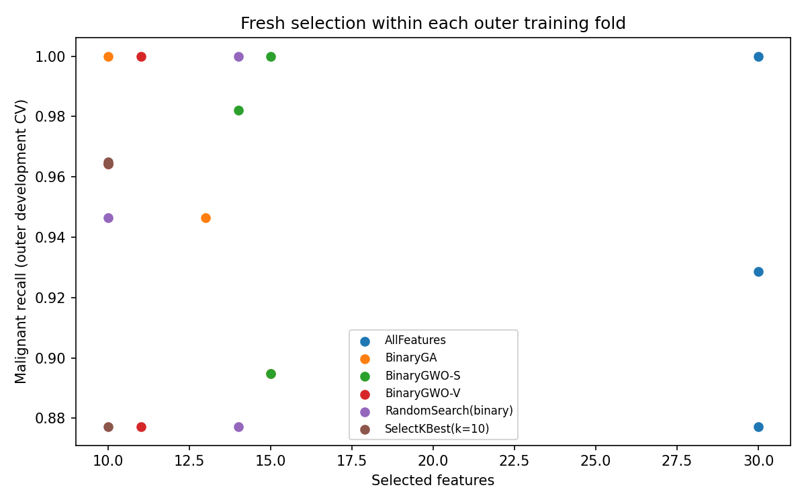
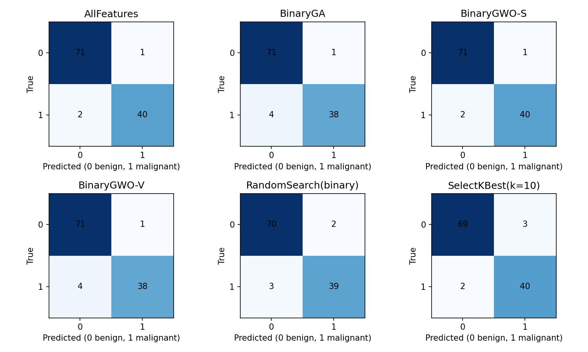

# Measured results

The complete predefined protocol was executed on 2026-11-10 with Python 3.12.14,
NumPy 2.2.6, SciPy 1.15.3 and scikit-learn 1.7.2, using a single CPU process and
one BLAS thread. These are actual measurements, not anticipated results.

The research question receives a mixed answer. Feature reduction was achieved,
but malignant recall was not consistently preserved. GWO-S used half the features
and matched AllFeatures' holdout confusion matrix. GA and GWO-V lost two additional
malignant detections; the small split cannot establish superiority or equivalence.
No method is selected for deployment or clinical use.

## Development estimates

Outer CV: three stratified folds on 455 development rows (170 malignant, 285 benign).
Fresh feature selection occurs inside each outer training fold. Entries below are
unweighted fold mean ± sample standard deviation, not confidence intervals.
FN lists the actual fold counts, in fold order. Inner fitness is deliberately
optimized and is not the score reported in this table.

| Method | Recall | F1 | ROC-AUC | Precision | Features (mean) | FN per fold |
|---|---:|---:|---:|---:|---:|---|
| AllFeatures | 0.9353 ± 0.0617 | 0.9516 ± 0.0159 | 0.9951 ± 0.0053 | 0.9719 ± 0.0338 | 30.00 | [0, 7, 4] |
| BinaryGA | 0.9471 ± 0.0526 | 0.9552 ± 0.0108 | 0.9944 ± 0.0051 | 0.9660 ± 0.0329 | 12.67 | [0, 6, 3] |
| BinaryGWO-S | 0.9590 ± 0.0563 | 0.9615 ± 0.0191 | 0.9966 ± 0.0036 | 0.9672 ± 0.0424 | 14.67 | [0, 6, 1] |
| BinaryGWO-V | 0.9472 ± 0.0632 | 0.9552 ± 0.0193 | 0.9963 ± 0.0034 | 0.9671 ± 0.0423 | 10.67 | [0, 7, 2] |
| RandomSearch(binary) | 0.9412 ± 0.0616 | 0.9521 ± 0.0154 | 0.9960 ± 0.0039 | 0.9669 ± 0.0422 | 12.67 | [0, 7, 3] |
| SelectKBest(k=10) | 0.9355 ± 0.0505 | 0.9405 ± 0.0285 | 0.9896 ± 0.0077 | 0.9464 ± 0.0171 | 10.00 | [2, 7, 2] |



Outer recall varied substantially across folds (e.g. AllFeatures: 1.0000, 0.8772,
0.9286). These folds and seeds are not independent clinical cohorts; no significance
claim or equivalence margin is inferred from three estimates.

## Full-development search variability

Each method performed three new training-only searches, seeds 0,1,2. The final
mask minimizes inner fitness with deterministic feature-count/seed/mask tie-breaks.
The table lists all three fitness values and feature counts, in seed order;
Jaccard is the mean of the three pairwise mask-set similarities.

| Method | Inner fitness (seeds 0,1,2) | Features (seeds 0,1,2) | Mean Jaccard | Frozen seed |
|---|---|---|---:|---:|
| BinaryGA | 0.037059, 0.042346, 0.037726 | 14, 13, 15 | 0.313 | 0 |
| BinaryGWO-S | 0.037912, 0.037711, 0.045803 | 14, 15, 12 | 0.415 | 1 |
| BinaryGWO-V | 0.036392, 0.034611, 0.040907 | 13, 9, 11 | 0.319 | 1 |
| RandomSearch(binary) | 0.038378, 0.040705, 0.042379 | 16, 12, 13 | 0.301 | 0 |

Low mask overlap (approximately 0.30–0.41) illustrates instability and interchangeable
correlated predictors. It does not establish which features are biologically
important. Final masks and ordered feature names are in freeze.json; bit 1 means
selected. Final feature counts differ from the outer-fold averages.

## One frozen final holdout result per method

Holdout: 114 rows, including 42 malignant and 72 benign. All methods use threshold
0.5. Matrix columns below are TN, FP, FN, TP (true/predicted order [0,1]). No final
mask or seed was chosen from this table.

| Method | Features | Recall | F1 | ROC-AUC | Precision | TN | FP | FN | TP |
|---|---:|---:|---:|---:|---:|---:|---:|---:|---:|
| AllFeatures | 30 | 0.9524 | 0.9639 | 0.9987 | 0.9756 | 71 | 1 | 2 | 40 |
| BinaryGA | 14 | 0.9048 | 0.9383 | 0.9947 | 0.9744 | 71 | 1 | 4 | 38 |
| BinaryGWO-S | 15 | 0.9524 | 0.9639 | 0.9891 | 0.9756 | 71 | 1 | 2 | 40 |
| BinaryGWO-V | 9 | 0.9048 | 0.9383 | 0.9848 | 0.9744 | 71 | 1 | 4 | 38 |
| RandomSearch(binary) | 16 | 0.9286 | 0.9398 | 0.9940 | 0.9512 | 70 | 2 | 3 | 39 |
| SelectKBest(k=10) | 10 | 0.9524 | 0.9412 | 0.9785 | 0.9302 | 69 | 3 | 2 | 40 |



A single additional false negative changes recall by 1/42 ≈ 2.38 percentage points.
GWO-S has the same thresholded confusion matrix as AllFeatures but lower ROC-AUC;
matching one confusion matrix does not demonstrate equivalent ranking or safety.
SelectKBest is competitive in recall with fewer features but more false positives.
The nine-feature GWO-V result is smaller yet misses four malignancies. No threshold
adjustment or hyperparameter revision followed holdout inspection.

## Optimization cost and timing

Each search method consumed 90 calls × (3 outer folds + 3 full-development seeds)
= 540 calls. Each nonempty call fitted three classifiers, producing 1,620 inner
fits per method. No empty masks occurred in this full run and no memoization was
used. Total across methods: **2,160 calls and 6,480 inner classifier fits**.

Each method also has three outer evaluation fits plus one final evaluation fit.
SelectKBest additionally fitted its training-only filter/classifier pipeline four
times while extracting masks. Thus the full study performed **6,508 classifier
fits**, including 4 redundant-but-counted filter-pipeline classifier fits.
The selected final search seed's 270 fits are a subset of the 810 fits spent on
that method's full-development repeats, not extra work.

| Method | Search wall seconds (all 6 searches) | Mean outer total seconds | Final fit seconds | Final prediction/metrics seconds |
|---|---:|---:|---:|---:|
| AllFeatures | 0.0000 | 0.0060 | 0.003380 | 0.004574 |
| BinaryGA | 5.3311 | 0.8636 | 0.001526 | 0.004505 |
| BinaryGWO-S | 5.4086 | 0.8777 | 0.001580 | 0.004158 |
| BinaryGWO-V | 5.4291 | 0.9136 | 0.001434 | 0.003885 |
| RandomSearch(binary) | 5.4417 | 0.8540 | 0.001500 | 0.003874 |
| SelectKBest(k=10) | 0.0000 | 0.0066 | 0.001265 | 0.003912 |

Wall times are perf_counter measurements on this runner, including Python/sklearn
overhead. Final prediction time includes metric computation. Outer total includes
selection and refit; search time includes inner fits. Full-development baseline
mask extraction was not timed separately. These are small workloads: timing noise
and different hardware matter. Equal calls control one resource, not total compute.

## Provenance, commands and verification

Source/protocol commit: `c4f8e0ab6ce6f1aa2fbdce4382e385d3aa3aab57`.
The development artifacts and frozen choices were committed in `05bd041` before
the full-study final command. Source hashes are recorded in environment.json.
Project 1's installed direct VCS revision is
`6b4ef0fa3d72f608146f3dd7eabb84bf39fa896e`.

The freeze SHA256 is
`457dd719aadd1e69215ac92d8cfe84e6f55dc112942fcf49f113ad8756007fa8`.
The machine-readable freeze and holdout-access manifests use UTC. The freeze was
recorded at 19:35:16.530946 Tehran time; final access started at 19:36:23.540751
and completed at 19:36:23.584136 on 2026-11-10. No full-study final rerun occurred.

Actual scientific commands, from the repository root:

```bash
export MPLCONFIGDIR=/tmp/p2-mpl XDG_CACHE_HOME=/tmp/p2-cache
export OMP_NUM_THREADS=1 OPENBLAS_NUM_THREADS=1 MKL_NUM_THREADS=1
.venv/bin/bcfs-study develop --output results/full
.venv/bin/bcfs-study final --output results/full
.venv/bin/bcfs-study report --output results/full
.venv/bin/python experiments/audit_results.py results/full
```

Development and final stdout are preserved in results/full. Report/audit commands
were repeated to verify derived artifacts and include the cost summary/stdout in
the checksum manifest; they never fit models or access raw holdout rows. The audit
passed SHA256 checks, partitions, fold nesting, exact budgets, fit accounting,
confusion-matrix metric equations, selected seed/mask rules and timestamp order.
ROC-AUC probability semantics are unit tested; the artifact-only audit cannot
reconstruct ROC-AUC without patient-level scores, which are not committed.

Fast verification actually run: 13 pytest tests passed; ruff lint and format passed;
standalone synthetic smoke and retained CLI smoke completed; sdist/wheel built;
a clean virtual environment installed the wheel and imported the package and all
four required Project 1 classes from outside the checkout. Hosted CI status is
reported in the PR and final handoff rather than inferred from local tests.

## Limitations and procedural caveat

- The dataset is small, historically curated and not a prospective clinical cohort.
  One split and a few errors cannot establish clinical performance or significance.
- Three outer folds and three search seeds are limited coverage. Inner selection
  can overfit; stability repeats are not new patient-level evidence.
- Fixed Logistic Regression, a predefined recall/F1/size trade-off, a short budget,
  and one filter size constrain conclusions. Larger or different protocols require
  preregistration and new confirmatory data, not tuning against this holdout.
- Correlated features allow different masks; selected-feature frequency is not
  causal evidence or clinical interpretability. No external validation was done.
- An initial automated preflight end-to-end test exercised the real-data final
  code path with a one-call pilot. Its performance values were not displayed,
  inspected or used for any choices. Subsequent tests/smokes use synthetic data.
  Thus the full-study split was untouched by model/seed/mask decisions, but a claim
  that its rows were never processed by any preflight code would be too strong.
- Source attribution/license follow the approved specification; no external UCI
  download was required. No raw predictors or patient-level predictions are stored.
- Reproducibility guards are local files, not tamper-proof controls. Scientific
  outputs are reproducible within numerical tolerances; wall times and figure
  rendering are machine-dependent. Future full reruns are computational reproductions,
  not independent holdout replications.
